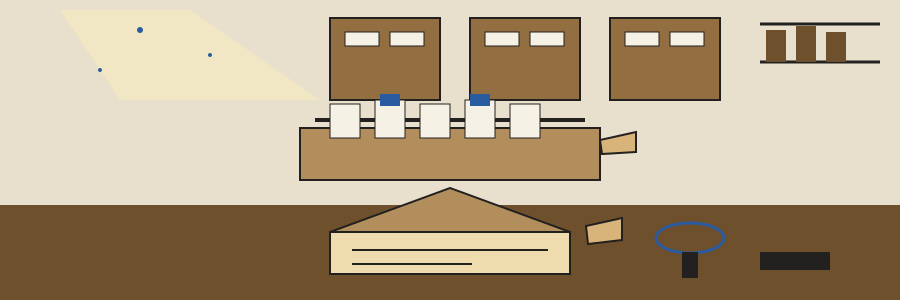

# dm-data-noise-adder

Catalogue entry, author first: the name above is set in Cairo in typewriter ribbon, with a small date stamp image at the left of this title block and the clipping envelope drawn small beside this first heading only.

# dm-data-noise-adder
Adds random noise to numerical data within a specified range to protect privacy while preserving statistical properties. Uses numpy for efficient numerical operations. - Focused on Tools designed to generate or mask sensitive data with realistic-looking but meaningless values

## Install
`git clone https://github.com/ShadowGuard-AI/dm-data-noise-adder`

> Catalogue entry: the README clone line names an older organisation.

## Usage
`python3 main.py input_file output_file column_name [options]`

## Parameters
- `-h`: Show help message and exit
- `--min_noise`: No description provided
- `--max_noise`: No description provided
- `--seed`: Random seed for reproducibility. Default: None

The output file must not name the input file. A run whose resolved output path is the input file, including through a `./` spelling or a symlink, is refused at exit 1 before any write.

> Catalogue entry: output must not name the input file.

> Catalogue entry: a ./ spelling of the same path is still the same file.

> Catalogue entry: a symlink to the input is still the input.

## License
This project is released under the MIT License. See the [LICENSE](LICENSE) file for details.

## Filed at the morgue desk

The main button of this re-skin reads Add the Noise. Its seed field label reads Random Seed. Its guard heading reads Output Never Names the Input. Its range heading reads Range Flags, Descriptions Missing. It ends with the envelope filed on the finished page, the edition complete, the press at rest upstairs, and the drawer pushed shut in the dark.
